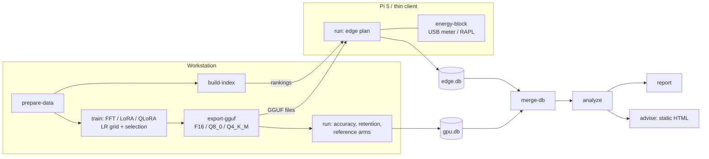

# slmbench

Benchmarking harness and decision-support advisor for the study *Evaluating how specialised language model
adaptation strategies influence the cost and performance of domain-specific AI systems under constrained
computational resources*. It adapts small models (FFT, LoRA, QLoRA, with the base model and RAG as comparators),
exports them to GGUF, measures accuracy, latency, memory and energy on a GPU workstation and on edge devices,
applies the hypothesis decision rules of `../DESIGN.md` (v2), and ranks deployable configurations under user
constraints.

Step-by-step execution on real hardware: [RUNBOOK.md](RUNBOOK.md).
Container-emulated edge pilot (base + RAG on a Docker host, no GPU): [../PILOT.md](../PILOT.md).
FFT/LoRA/QLoRA on a free Kaggle/Colab T4 or your own NVIDIA GPU (notebook `../training/kaggle_train.ipynb`):
[../TRAINING-GPU.md](../TRAINING-GPU.md).

## Architecture



## Module map

| Module | Responsibility |
|---|---|
| `config.py` | Load/validate `configs/matrix.yaml` and device profiles; expand plans; stable `config_id`; run counts; training jobs |
| `db.py` | SQLite schema (DESIGN.md 4), resumable inserts, `is_mock` propagation, energy blocks, `merge_dbs` |
| `datasets/` | PubMedQA, FinQA, ARC-Easy normalisation; seeded, stratified and class-balanced sampling; sha256 manifests |
| `prompts.py` | Fixed templates, chat-template rendering, FinQA unit serialisation, context truncation |
| `scoring.py` | PubMedQA labels, FinQA numeric and yes/no matching, ARC letters, accuracy, macro-F1, per-class recall |
| `rag.py` | BM25 index, precomputed top-K rankings, recall@K |
| `template_check.py` | Chat-template parity check between training render and llama-server |
| `backends/` | `llamacpp` (primary, server `timings`, `cache_prompt: false`), `vllm` (reference), `ollama`, `mock` |
| `telemetry/` | Sampler threads, trapezoid energy, NVML, PSS/RSS, RAPL, Pi PMIC + throttle, tegrastats, thermal, USB-meter CSV |
| `runner.py` | Seeded block order, interleaved energy repeats, warm-up, prompts built before the energy window, meter-based idle baseline, cool-down gate, throttle re-run, resume |
| `train.py`, `export.py` | transformers + peft + bitsandbytes training (CUDA, or CPU with bf16 autocast and peak RSS in place of VRAM), LR selection; adapter merge, GGUF convert/quantize |
| `stats.py` | Wilcoxon, Friedman, Kendall's W, exact McNemar, Cochran's Q, Newcombe CI, non-inferiority, Page's L, bootstrap, Holm, floor rule, break-even |
| `analysis.py` | Tidy tables, v2 hypothesis decisions, accuracy parity, cost, CO2e, break-even |
| `report.py` | Markdown tables, PNG figures, `hypothesis_decisions.md`; refuses mock data unless `--allow-mock`, then watermarks |
| `advise.py` | Constraint filtering and ranking; self-contained HTML |
| `preflight.py` | Read-only readiness check (`slmbench preflight --device ...`): libraries, server/`--jinja`, model sha256, governor, throttling/temperature, RAPL, NVML, meter CSV freshness, disk, DB |
| `estimate.py`, `env.py`, `cli.py` | Pilot-based wall-clock projection; environment capture; argparse CLI |
| `energy_estimate.py`, `telemetry/cgroup.py` | Container CPU time and memory from cgroup v1/v2 (in-harness or joined from host 1 Hz samples) and the Green Algorithms energy ESTIMATE (`energy-estimate`; "estimated from CPU time, not metered", kept apart from measured energy). See [../TRAINING-CPU.md](../TRAINING-CPU.md) |

## Install and test

```bash
python3 -m venv .venv && . .venv/bin/activate
pip install -e ".[edge,rag,analysis,dev]"     # add [gpu] on the workstation
pytest
```

Mock data is refused everywhere outside tests: `analyze`, `report` and `advise` exit 3 when the DB has
`is_mock` rows unless `--allow-mock` is passed, and then watermark every output (Markdown, PNG metadata, CSV
`watermark` column, advisor HTML). `check-template` compares the training chat template with llama-server's
`/apply-template` (servers run with `--jinja`).

The suite is offline and takes seconds: hand-made toy fixtures in `tests/fixtures/raw/` (not benchmark items),
the mock backend, and no torch/transformers. Rows written by the mock backend carry `is_mock=1`.
